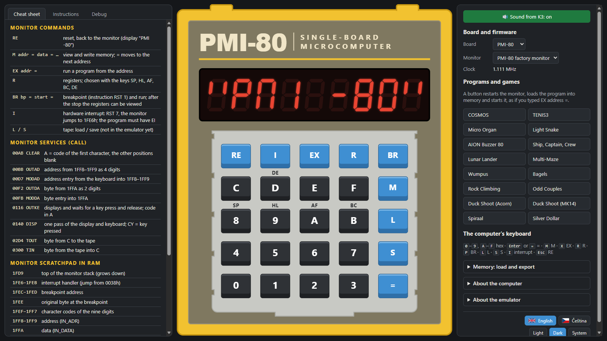

<div align="center">

# Wolf80

[](https://holyszewski.github.io/Wolf80/)

**[holyszewski.github.io/Wolf80](https://holyszewski.github.io/Wolf80/)** · nic se neinstaluje ·
také jako [EXE pro Windows a offline HTML soubor](../../releases/latest)

**Emulátor československých jednodeskových počítačů PMI-80 a Savia-84**

[English](README.md) · Česky

[](LICENSE)




</div>

Wolf80 spouští v prohlížeči PMI-80, osmibitový školní mikropočítač, který od roku 1982 vyráběla TESLA
Piešťany, a amatérsky stavěnou Savii-84. Jejich původní monitory běží na vlastních jádrech 8080
a Z80 a displej, klávesnice i zvuk se chovají tak, jak je program na skutečné desce ovládá.
Je k dispozici jako [webová stránka](https://holyszewski.github.io/Wolf80/), která běží v každém
moderním prohlížeči včetně telefonu, a jako samostatné EXE pro Windows nebo offline HTML soubor;
nic se neinstaluje.

## Proč

Wolf80 jsem vyrobil, aby:

- šlo snáze **psát, zkoušet a ladit programy** pro PMI-80 a Savii-84, aniž bych musel hned
  vyndávat skutečnou desku ze sbírky;
- šlo **experimentovat** s programy a hrami jiných autorů;
- se usnadnil **další vývoj** vlastních programů a hardwaru pro PMI-80 a Savii-84;
- si PMI-80 mohl **osahat i ten, kdo nemá štěstí ho vlastnit**, a vyzkoušet, jak se s
  takovými počítači pracovalo: jak se program zadával bajt po bajtu přes monitor,
  prostřednictvím displeje a hexadecimální klávesnice z kalkulačky;
- v rámci toho jsem **rozšířil skromnou sbírku her** pro PMI-80 a příbuzné počítače o klasické
  hry z jiných jednodeskových počítačů té doby (KIM-1, TK-80, Acorn System 1, MK14), napsané pro
  tyto desky znovu: hrají se v emulátoru a díky souborům HEX a seznamům bajtů i na skutečných
  deskách.

## Počítače

| | Rok | Procesor | Paměť | Firmware ve Wolf80 |
|---|---|---|---|---|
| **PMI-80** od TESLA Piešťany | 1982 | MHB8080A (Intel 8080), 1,111 MHz | 1 KiB ROM, 1 KiB RAM | tovární monitor · PMI-80 C s EPROM her |
| **Savia-84**, stavebnice z knihy *Radioamatérské konstrukce 4* | 1984/1990 | Z80 (U880), 2 MHz | 1 KiB ROM, 2 KiB RAM | tovární monitor |
| **Stone 1** Radka Veselého, moderní kříženec obou | 2018 | Z80, 2 MHz | 2 KiB ROM, 2 KiB RAM | STONE-PMI |

## Co umí

- 🖥️ **Věrné desky**: vlastní jádra osmibitových procesorů Intel 8080 a Z80 (jádro 8080 projde testem 8080EXM, jádro Z80
  testy ZEXDOC a ZEXALL), obvod 8255, mapy paměti s jejich zrcadlením a prázdnými místy a
  multiplexní displej, jehož jas vychází z toho, jak dlouho která číslice svítí, stejně jako na
  skutečné desce.
- 🎮 **Hry a dema připravené ke spuštění**: COSMOS a TENIS3, klasické hry z KIM-1, TK-80, Acorn
  System 1 a MK14 napsané pro tyto desky znovu (Lunar Lander, Wumpus, Multi-Maze, Bagels, Duck
  Shoot…), kostková hra, hudební demo a další. Kliknutí spustí program stejně, jako by se
  spouštěl na skutečné desce.
- 🔊 **Zvuk** z výstupu pro magnetofon, přes virtuální zesilovač.
- 📖 **Tahák a tabulka instrukcí**: příkazy monitoru, služby ROM a mapa paměti zvolené desky a
  tabulka instrukcí 8080 s kódy, bajty a takty.
- 🔍 **Ladění**: registry, porty 8255, disassembler od PC a hexadecimální pohled na celý adresní
  prostor. Úpravy paměti a registrů, body přerušení a editor s assemblerem se chystají.
- 💾 **Nahrání a export**: Intel HEX, BIN a hex text do paměti; ven HEX a BIN a u PMI-80 i
  nahrávka pro magnetofon ve WAV, kterou lze přehrát do skutečné desky.
- 🔌 **I pro skutečné desky**: každý program ve složkách [`programs/`](programs/) a
  [`extras/`](extras/) má vedle sebe soubor Intel HEX a seznam bajtů k ručnímu zadání.
- ⌨️ **Myš, dotyk nebo klávesnice počítače**; funguje i na telefonu.
- 🌗 **Angličtina a čeština**, tmavý a světlý vzhled.
- 🪶 **Bez instalace a bez závislostí**: jedna webová stránka, k tomu jeden offline HTML soubor a
  jedno EXE pro Windows.

## Kde ho vzít

- **Web**: [holyszewski.github.io/Wolf80](https://holyszewski.github.io/Wolf80/), nic se
  neinstaluje.
- **Windows**: `Wolf80.exe` ze [stránky posledního vydání](../../releases/latest). Je to jeden
  soubor, nic se neinstaluje; potřebuje Microsoft Edge WebView2 Runtime, který Windows 11 a
  většina instalací Windows 10 už má.
- **Offline**: `Wolf80-offline.html` ze stejného vydání se otevře v každém moderním prohlížeči bez
  připojení.

## Sestavení ze zdrojů

Node.js 20 nebo novější, žádné balíčky se neinstalují:

```
npm test                    # testy
node tools/build.mjs        # dist/web a dist/Wolf80-offline.html
node tools/serve.mjs 8780   # dist/web na http://127.0.0.1:8780/
```

EXE pro Windows sestaví `node tools/build-desktop.mjs`; potřebné nástroje popisuje
[docs/desktop.md](docs/desktop.md).

## Dokumentace

Dokumentace v repozitáři je anglicky:

- [PMI-80](docs/pmi80.md), [Savia-84](docs/savia84.md), [Stone 1](docs/stone1.md): jak je každá
  deska emulována, s mírou jistoty a zdrojem každého údaje.
- [Ukázkové programy](programs/README.md) a [extras](extras/README.md): původ každého programu.
- [Obrazy ROM](roms/README.md): původ každé ROM.
- [Seznam změn](CHANGELOG.md)

## Poděkování

ROM a mnohé programy nejsou dílem tohoto projektu. Jsou zde s uvedením autorů a nevztahuje se na
ně jeho licence:

- tovární monitor PMI-80 (TESLA Piešťany, 1982) a monitor Savie-84 od Ing. Václava Krause;
- **[Nostalcomp](https://www.nostalcomp.cz/)**, který velkou část tohoto softwaru uchoval a
  zpřístupnil a vytvořil monitory PMI-80 C a STONE-PMI;
- COSMOS od Jiřího Šutery, TENIS ze slovenského aplikačního listu mikroelektroniky;
- autoři původních her: Jim Butterfield, Stan Ockers a Gregory Yob, M. Kishida, Teruhisa Hishida,
  A. W. den Hartog, Acorn Computers a Science of Cambridge;
- Radek Veselý za Stone 1.

Podrobnosti i se zdroji jsou v [roms/README.md](roms/README.md) a
[programs/README.md](programs/README.md) a v aplikaci v části „O emulátoru“.

## Vytvořeno s pomocí AI

Wolf80 byl navržen a vyzkoušen jeho autorem, kód a dokumentace byly napsány s pomocí AI Claude
(Anthropic). Chování desek bylo ověřeno podle původní dokumentace, obsahu ROM a na autorových
vlastních PMI-80 a Savii-84.

## Zapojení

Hlášení chyb, poznatky o skutečných deskách i pull requesty jsou vítány. Než se pull request
přijme, přispěvatel jednou odsouhlasí [Contributor License Agreement](CLA.md) (anglicky): autorská
práva mu zůstávají a autor projektu smí projekt vydat i pod jinými podmínkami než GPL. Podrobnosti
jsou v [CONTRIBUTING.md](CONTRIBUTING.md).

## Licence

Copyright (c) 2026 Matěj „Wolf“ Holyszewski.

Wolf80 je svobodný software: můžete ho šířit a upravovat za podmínek licence
[GNU General Public License](LICENSE) ve znění Free Software Foundation, verze 3, nebo (podle vaší
volby) kterékoli pozdější verze. Šíří se v naději, že bude užitečný, ale BEZ JAKÉKOLI ZÁRUKY, i bez
předpokládané záruky PRODEJNOSTI nebo VHODNOSTI PRO URČITÝ ÚČEL. Závazné je anglické znění licence.

Na obrazy ROM ve složce `roms/` a na programy jiných autorů ve složce `programs/` se tato licence
nevztahuje; u každého je uveden autor a původ.
