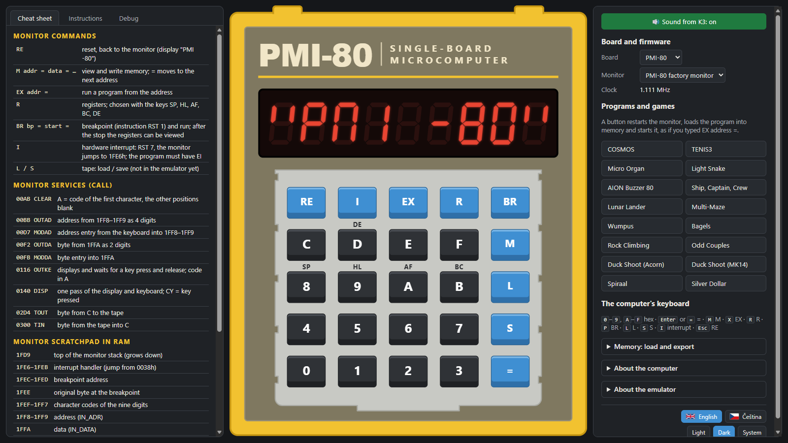

<div align="center">

# Wolf80

[](https://holyszewski.github.io/Wolf80/)

**[holyszewski.github.io/Wolf80](https://holyszewski.github.io/Wolf80/)** · nothing to install ·
also as a [Windows EXE and an offline HTML file](../../releases/latest)

**An emulator of Czechoslovak single-board computers: PMI-80 and Savia-84**

English · [Česky](README.cs.md)

[](LICENSE)




</div>

Wolf80 runs the PMI-80, the 8-bit school microcomputer made by TESLA Piešťany from 1982, and the
home-built Savia-84 in a web browser. Their original monitors run on the emulator's own 8080 and
Z80 cores, and the display, the keyboard and the sound are modelled as the real boards drive them.
It is available as a [web page](https://holyszewski.github.io/Wolf80/) that runs in any modern
browser, phones included, and as a single Windows EXE or an offline HTML file; nothing to install.

## Why

I made Wolf80:

- to make it easier to **write, test and debug programs** for the PMI-80 and the Savia-84,
  without having to dig a real board out of a collection first;
- to **experiment** with programs and games by other people;
- to help with the **future development** of new programs and hardware for the PMI-80 and the
  Savia-84;
- to let **anyone who does not own a PMI-80** try it and get a feel for how such computers
  were used: how a program was typed in byte by byte through the monitor, with
  the display and hexadecimal keypad of a calculator;
- and along the way I **widened the small collection of games** for the PMI-80 and its relatives
  with classic games of other single-board computers of the time (KIM-1, TK-80, Acorn System 1,
  MK14), written anew for these boards: they play in the emulator and, from their HEX files and
  byte lists, on the real boards too.

## The computers

| | Year | Processor | Memory | Firmware in Wolf80 |
|---|---|---|---|---|
| **PMI-80** by TESLA Piešťany | 1982 | MHB8080A (Intel 8080), 1.111 MHz | 1 KiB ROM, 1 KiB RAM | factory monitor · PMI-80 C with a game EPROM |
| **Savia-84**, a build-it-yourself board from the book *Radioamatérské konstrukce 4* | 1984/1990 | Z80 (U880), 2 MHz | 1 KiB ROM, 2 KiB RAM | factory monitor |
| **Stone 1** by Radek Veselý, a modern cross of the two | 2018 | Z80, 2 MHz | 2 KiB ROM, 2 KiB RAM | STONE-PMI |

## Features

- 🖥️ **Faithful boards**: own cores of the 8-bit Intel 8080 and Z80 (the 8080 core passes 8080EXM, the Z80 core
  ZEXDOC and ZEXALL), the 8255, the memory maps with their mirrors and gaps, and the multiplexed
  display, whose brightness comes from how long each digit is lit, as on the real board.
- 🎮 **Games and demos, ready to play**: COSMOS and TENIS3, classic games of the KIM-1, TK-80,
  Acorn System 1 and MK14 written anew for these boards (Lunar Lander, Wumpus, Multi-Maze, Bagels,
  Duck Shoot…), a dice game, a music demo and more. A click starts a program the way you would
  start it on the real board.
- 🔊 **Sound** from the tape output, through a virtual amplifier.
- 📖 **Cheat sheet and opcode table**: monitor commands, ROM services and the memory map of the
  chosen board, and the 8080 instruction table with codes, bytes and states.
- 🔍 **Debugging**: registers, the 8255 ports, a disassembly at PC and a hex view of the whole
  address space. Editing memory and registers, breakpoints and an editor with an assembler are
  planned.
- 💾 **Load and export**: Intel HEX, BIN and hex text into memory; HEX and BIN out, and for the
  PMI-80 a WAV tape recording you can play into a real board.
- 🔌 **For the real boards too**: every program in [`programs/`](programs/) and
  [`extras/`](extras/) comes with an Intel HEX file and a list of bytes to type in by hand.
- ⌨️ **Mouse, touch or PC keyboard**; works on a phone too.
- 🌗 **English and Czech**, dark and light theme.
- 🪶 **No installation, no dependencies**: one web page, also as a single offline HTML file and a
  single Windows EXE.

## Get it

- **Web**: [holyszewski.github.io/Wolf80](https://holyszewski.github.io/Wolf80/), nothing to
  install.
- **Windows**: download `Wolf80.exe` from the [latest release](../../releases/latest). It is one
  file, nothing is installed; it needs the Microsoft Edge WebView2 Runtime, which Windows 11 and
  most Windows 10 installations already have.
- **Offline**: `Wolf80-offline.html` from the same release opens in any modern browser without a
  connection.

## Building from source

Node.js 20 or newer, no packages to install:

```
npm test                    # unit tests
node tools/build.mjs        # dist/web and dist/Wolf80-offline.html
node tools/serve.mjs 8780   # serves dist/web on http://127.0.0.1:8780/
```

The Windows EXE is built by `node tools/build-desktop.mjs`; the toolchain is described in
[docs/desktop.md](docs/desktop.md).

## Documentation

- [PMI-80](docs/pmi80.md), [Savia-84](docs/savia84.md), [Stone 1](docs/stone1.md): how each board
  is modelled, with the certainty and source of every fact.
- [Demo programs](programs/README.md) and [extras](extras/README.md): origin of every program.
- [ROM images](roms/README.md): origin of every ROM.
- [Changelog](CHANGELOG.md)

## Thanks and credits

The ROMs and many of the programs are not the work of this project. They are included with credit
and are not covered by its license:

- the PMI-80 factory monitor (TESLA Piešťany, 1982) and the Savia-84 monitor by Ing. Václav Kraus;
- **[Nostalcomp](https://www.nostalcomp.cz/)**, who preserved and shared much of this software and
  made the PMI-80 C and STONE-PMI monitors;
- COSMOS by Jiří Šutera, TENIS from a Slovak microelectronics application sheet;
- the authors of the original games: Jim Butterfield, Stan Ockers and Gregory Yob, M. Kishida,
  Teruhisa Hishida, A. W. den Hartog, Acorn Computers and Science of Cambridge;
- Radek Veselý for the Stone 1.

The details, with sources, are in [roms/README.md](roms/README.md) and
[programs/README.md](programs/README.md), and in the app under "About the emulator".

## Made with AI assistance

Wolf80 was designed and tested by its author; its code and documentation were written with the help
of the AI Claude (Anthropic). The boards were checked against the original documentation, the ROMs and
the author's own PMI-80 and Savia-84.

## Contributing

Bug reports, facts about the real boards and pull requests are welcome. Before a pull request is
merged, contributors agree once to the [Contributor License Agreement](CLA.md): you keep the
copyright, and the author may also publish the project under other terms besides the GPL. Details
are in [CONTRIBUTING.md](CONTRIBUTING.md).

## License

Copyright (c) 2026 Matěj "Wolf" Holyszewski.

Wolf80 is free software: you can redistribute it and/or modify it under the terms of the
[GNU General Public License](LICENSE) as published by the Free Software Foundation, either version 3
of the License, or (at your option) any later version. It is distributed in the hope that it will be
useful, but WITHOUT ANY WARRANTY; without even the implied warranty of MERCHANTABILITY or FITNESS FOR
A PARTICULAR PURPOSE.

The ROM images in `roms/` and the programs by other authors in `programs/` are not covered by this
license; each names its author and origin.
